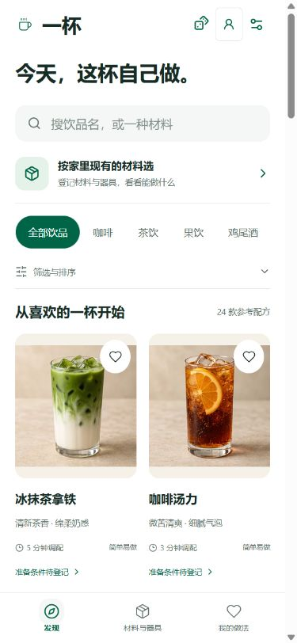

# 一杯 · OneCup Personal

**无需登录、自己部署、用手边材料做一杯。**

[文档导航](docs/README.md) · [部署](docs/guides/DEPLOYMENT.md) · [Docker](docs/guides/DOCKER.md) · [数据与备份](docs/guides/STORAGE.md) · [路线图](docs/product/ROADMAP.md) · [许可证](LICENSE)

v0.3 使用 **Node.js + 服务端 SQLite + Docker 持久数据卷**。记录保存到服务器；更换浏览器或清理站点数据后，重新连接同一实例即可读取。一个实例对应一份私人工作区，所有连接设备共用记录，没有账号和社交功能。

> 仅限个人非商业使用，必须标注来源。自定义许可不属于 OSI 开源许可；商业或组织使用需要另行授权，见 LICENSE。

## Docker 部署

需要 Docker Engine / Docker Desktop 与 Compose v2，首次构建需联网。

```sh
git clone https://github.com/Murphy-404/OneCup.git
cd OneCup
docker compose up -d --build
```

打开 **http://127.0.0.1:8080/**。无需账号或数据库密码。数据库自动创建在命名卷 **onecup_personal_data** 的 /data/onecup.sqlite。

```sh
docker compose ps
docker compose logs -f
docker compose down
docker compose up -d --build
```

正常停止、升级、重建容器会保留命名卷。不要删除数据卷或使用带删卷选项的停止命令。卷不能保护磁盘故障，请把备份复制到另一台设备。详细更新、恢复、权限与远程配置见 [Docker 指南](docs/guides/DOCKER.md)。

**默认只允许本机访问。** 能连接实例的人可以读取和修改全部记录。远程使用应限制在可信网络/VPN，或通过带访问控制的 HTTPS 反向代理；Origin 检查不能代替认证。

## 本地运行与开发

需要 Node.js 24+。

```sh
npm ci
npm run build
npm start
```

访问 http://127.0.0.1:8080/，数据库默认 data/onecup.sqlite。开发时运行 npm run dev，同时启动 Vite（5173）与 API（3001）。生产运行必须包含 Node API；仅上传 dist/ 到静态主机不能保存数据。

## 当前功能

- 24 款家庭参考配方，分类、搜索、主动随机、材料与器具登记。
- 有条件的替代与自制、逐项撤销、0.5～20 份用量换算、分步制作与计时。
- 收藏与个人做法完整快照、多杯备料和同规格基底合批。
- **自建配方编辑器**：空白创建或复制参考配方，材料规格、数量、器具、步骤、前置时间、来源与备注；未完成可存草稿，校验后才能制作。
- **私人合集**：命名、说明、排序、复制、导出，保存固定快照；来源更新时主动更新，删除来源后仍能查看制作。每个合集最多 50 条，最多 100 个合集。
- 咖啡萃取工作台，意式参数可在自制浓缩向导中复用；出液重量不自动当作体积。
- 服务端 SQLite 保存、跨设备版本冲突检测、JSON 导入导出、SQLite 一致性备份与恢复。

参考配方和替代规则仍待实际试做。库存仅检查材料种类；图片是 AI 示意，自建配方用默认占位，不冒用其他饮品图片。刷新或离开制作后计时结束，暂无后台通知或离线保存。

## 数据与备份

页面「服务器数据与备份」可以导出 JSON、校验后确认恢复，以及主动导入旧浏览器记录。保存失败时先导出当前页面修改再重试。

服务器默认启动时及每 24 小时生成 SQLite 快照，位于 data/backups（Docker 为 /data/backups）；不自动清理，需检查磁盘空间并定期离机备份。手动备份：

```sh
docker compose exec -T onecup node server-dist/cli.mjs backup /data/backups/manual.sqlite
docker compose cp onecup:/data/backups/manual.sqlite ./onecup-backup.sqlite
```

v1 JSON 导入自动升级为 v2；v2 包含自建配方和合集。恢复会替换整个实例的记录，必须先保留当前备份。[完整备份与恢复流程](docs/guides/STORAGE.md)。

## 验证与贡献

```sh
npm test
npm run build
npm run audit:content
```

GitHub Actions 在 Windows/Linux 运行构建和测试，并实际构建 Docker、写入记录、重建容器、验证数据保留和 SQLite 恢复。具体用例与人工验证边界见 [验证记录](docs/testing/VALIDATION.md)。

[贡献指南](CONTRIBUTING.md) · [安全说明](SECURITY.md) · [第三方许可](THIRD_PARTY_NOTICES.md) · [素材说明](docs/reference/ASSETS.md)


